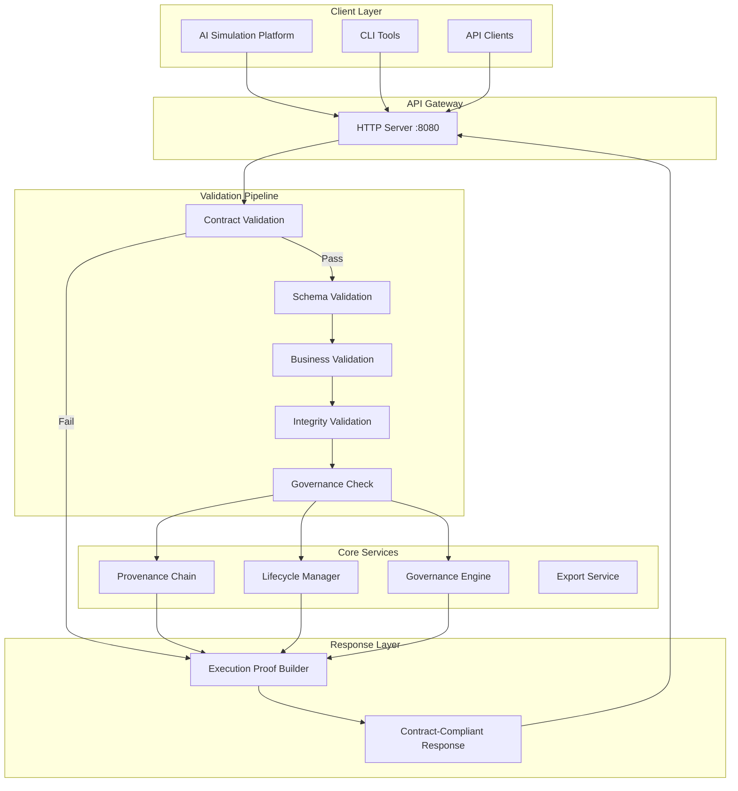

<p align="center">
  
</p>

<h1 align="center">Agentics Deployment Intent</h1>

<p align="center">
  <strong>Semantic Bridge Between AI Simulations and Production Deployment Infrastructure</strong>
</p>

<p align="center">
  <a href="https://github.com/agentics/deployment-intent/actions"></a>
  <a href="https://agentics-deployment-intent-1062287243982.us-central1.run.app/health"></a>
  <a href="#"></a>
  <a href="#"></a>
  <a href="#"></a>
  <a href="LICENSE"></a>
</p>

<p align="center">
  <a href="#-quick-start">Quick Start</a> •
  <a href="#-features">Features</a> •
  <a href="#-api-reference">API</a> •
  <a href="#-contract-enforcement">Contracts</a> •
  <a href="#-deployment">Deployment</a>
</p>

---

## 🎯 Overview

**Agentics Deployment Intent** is a production-grade validation and governance system that bridges the gap between AI simulation environments (like RuvVector) and real-world deployment infrastructure. It ensures that deployment intents from simulation platforms are rigorously validated, governed, and traceable before reaching production systems.

```
┌─────────────────────┐     ┌──────────────────────────┐     ┌─────────────────────┐
│   AI Simulation     │────▶│  Deployment Intent API   │────▶│  Infrastructure     │
│   (RuvVector)       │     │  ══════════════════════  │     │  Orchestration      │
│                     │     │  • Contract Validation   │     │                     │
│  • Agent Scenarios  │     │  • Governance Rules      │     │  • Kubernetes       │
│  • Cost Projections │     │  • Provenance Tracking   │     │  • Cloud Run        │
│  • Risk Analysis    │     │  • Lifecycle Management  │     │  • Terraform        │
└─────────────────────┘     └──────────────────────────┘     └─────────────────────┘
```

## ✨ Features

<table>
<tr>
<td width="50%">

### 🛡️ Contract Enforcement
- **Strict JSON Schema validation** using Ajv
- Rejects unknown properties (no data leakage)
- Validates all 17 required intent fields
- Zero tolerance for malformed payloads

</td>
<td width="50%">

### 📜 Provenance Tracking
- Immutable audit chain
- Cryptographic content hashing
- Full actor attribution
- Tamper-evident records

</td>
</tr>
<tr>
<td width="50%">

### ⚖️ Governance Framework
- Configurable approval workflows
- Multi-tier authorization
- Compliance constraint evaluation
- Exception policy management

</td>
<td width="50%">

### 🔄 Lifecycle Management
- 11 distinct lifecycle states
- Guard-protected transitions
- Rollback capabilities
- State machine enforcement

</td>
</tr>
<tr>
<td width="50%">

### 📊 Execution Proof
- Multi-layer participation tracking
- Execution graphs with relationships
- Validation hash for integrity
- Complete audit trail

</td>
<td width="50%">

### 🏢 Enterprise Ready
- ERP capability integration
- Organization topology support
- Cost envelope management
- Risk tolerance specification

</td>
</tr>
</table>

## 🏗️ Architecture



## 🚀 Quick Start

### Installation

```bash
# Clone the repository
git clone https://github.com/agentics/deployment-intent.git
cd deployment-intent

# Install dependencies
npm install

# Build the project
npm run build

# Start the server
npm start
```

### Docker

```bash
# Build the image
docker build -t agentics-deployment-intent .

# Run the container
docker run -p 8080:8080 agentics-deployment-intent
```

### Verify Installation

```bash
# Health check
curl http://localhost:8080/health

# API info
curl http://localhost:8080/v1/intent
```

## 📡 API Reference

### Base URL

| Environment | URL |
|-------------|-----|
| **Production** | `https://agentics-deployment-intent-1062287243982.us-central1.run.app` |
| **Local** | `http://localhost:8080` |

### Endpoints

#### `GET /health`

Health check endpoint.

<details>
<summary>Response Example</summary>

```json
{
  "success": true,
  "data": {
    "status": "healthy",
    "service": "agentics-deployment-intent",
    "timestamp": "2026-01-08T04:08:39.612Z",
    "contractEnforcement": "enabled"
  },
  "version": "1.0.0",
  "schemaVersion": "1.0.0",
  "executionProof": {
    "layers_executed": [
      {
        "layer_id": "resolution-uuid",
        "layer_type": "RESOLUTION",
        "executed_at": "2026-01-08T04:08:39.612Z",
        "status": "PASSED"
      }
    ]
  }
}
```
</details>

---

#### `GET /v1/intent`

API information and capabilities.

<details>
<summary>Response Example</summary>

```json
{
  "success": true,
  "data": {
    "service": "Agentics Deployment Intent API",
    "description": "Semantic bridge between RuvVector simulations and deployment infrastructure",
    "endpoints": {
      "POST /v1/intent/validate": "Validate a deployment intent (contract-enforced)",
      "GET /v1/intent/schema": "Get the deployment intent schema version"
    },
    "capabilities": [
      "Contract validation (Ajv strict mode)",
      "Schema validation",
      "Business rule validation",
      "Referential integrity checks",
      "Governance compliance",
      "ERP capability reference validation",
      "Execution proof generation"
    ],
    "contractEnforcement": {
      "enabled": true,
      "schemaPath": "intent/v1/request.schema.json",
      "strictMode": true,
      "rejectsUnknownProperties": true
    }
  }
}
```
</details>

---

#### `GET /v1/intent/schema`

Schema version and lifecycle states.

---

#### `POST /v1/intent/validate`

**Validate a deployment intent document.**

This is the primary endpoint for validating deployment intents. All requests undergo strict contract validation before any business logic executes.

**Request Headers:**
```
Content-Type: application/json
```

**Request Body:** A complete deployment intent document (see [Intent Schema](#-intent-schema))

<details>
<summary>Success Response (200)</summary>

```json
{
  "success": true,
  "data": {
    "valid": true,
    "findings": [],
    "summary": {
      "totalFindings": 0,
      "errors": 0,
      "warnings": 0,
      "info": 0
    },
    "validationDurationMs": 12,
    "phasesExecuted": ["schema", "business", "integrity", "governance"]
  },
  "executionProof": {
    "layers_executed": [
      {
        "layer_id": "contract-validation-uuid",
        "layer_type": "CONTRACT_VALIDATION",
        "status": "PASSED"
      },
      {
        "layer_id": "schema-validation-uuid",
        "layer_type": "SCHEMA_VALIDATION",
        "status": "PASSED"
      },
      {
        "layer_id": "business-validation-uuid",
        "layer_type": "BUSINESS_VALIDATION",
        "status": "PASSED"
      },
      {
        "layer_id": "integrity-validation-uuid",
        "layer_type": "INTEGRITY_VALIDATION",
        "status": "PASSED"
      }
    ],
    "execution_graph": {
      "root_layer": "contract-validation-uuid",
      "edges": [...]
    },
    "total_execution_time_ms": 15,
    "validation_hash": "sha256..."
  }
}
```
</details>

<details>
<summary>Contract Validation Error (400)</summary>

```json
{
  "success": false,
  "error": {
    "code": "CONTRACT_VALIDATION_FAILED",
    "message": "Request payload does not conform to the contract schema",
    "details": [
      {
        "path": "/",
        "message": "must have required property 'intentId'",
        "code": "REQUIRED_FIELD_MISSING",
        "keyword": "required",
        "params": { "missingProperty": "intentId" }
      },
      {
        "path": "/",
        "message": "must NOT have additional properties",
        "code": "UNEXPECTED_PROPERTY",
        "keyword": "additionalProperties",
        "params": { "additionalProperty": "unknownField" }
      }
    ]
  },
  "executionProof": {
    "layers_executed": [
      {
        "layer_type": "CONTRACT_VALIDATION",
        "status": "FAILED",
        "findings_count": 18
      }
    ]
  }
}
```
</details>

## 📋 Intent Schema

A deployment intent document requires the following fields:

| Field | Type | Description |
|-------|------|-------------|
| `intentId` | `uuid` | Unique identifier for the deployment intent |
| `intentVersion` | `semver` | Semantic version of this intent document |
| `schemaVersion` | `semver` | Schema version this document conforms to |
| `createdAt` | `date-time` | ISO 8601 creation timestamp |
| `createdBy` | `ActorReference` | Actor who created this intent |
| `source` | `SimulationReference` | Reference to source simulation |
| `state` | `LifecycleState` | Current lifecycle state |
| `organizationalTopology` | `object` | Organization structure |
| `agentClasses` | `AgentClassCollection` | Agent class definitions |
| `interactionVolumes` | `object` | Expected interaction volumes |
| `costEnvelopes` | `CostEnvelopeCollection` | Cost constraints |
| `governanceConstraints` | `object` | Governance rules |
| `riskTolerances` | `object` | Risk tolerance specification |
| `integrationTouchpoints` | `object` | Integration endpoints |
| `infrastructureExpectations` | `object` | Infrastructure requirements |
| `provenance` | `ProvenanceChain` | Complete audit chain |
| `intentClassification` | `object` | SIMULATED or EXECUTABLE |

### Lifecycle States

```
DRAFT ──▶ PENDING_VALIDATION ──▶ VALIDATED ──▶ PENDING_APPROVAL ──▶ APPROVED
                                                                        │
                    ┌───────────────────────────────────────────────────┘
                    ▼
               STAGED ──▶ DEPLOYING ──▶ DEPLOYED
                              │             │
                              ▼             ▼
                           FAILED      ROLLED_BACK ──▶ ARCHIVED
```

## 🛡️ Contract Enforcement

All incoming requests are validated against a strict JSON Schema contract before any business logic executes.

### Validation Configuration

```typescript
{
  strict: true,           // Enable all strict mode checks
  allErrors: true,        // Collect all validation errors
  removeAdditional: false, // Reject (don't remove) unknown properties
  useDefaults: false,     // Don't insert default values
  coerceTypes: false,     // Don't coerce types
  validateFormats: true,  // Validate string formats (uuid, date-time, email)
  strictSchema: true,     // Strict schema compilation
  strictNumbers: true,    // Strict number validation
  strictTypes: true,      // Strict type validation
  strictRequired: true    // Strict required field validation
}
```

### Execution Proof

Every response includes an `executionProof` object that documents which validation layers participated:

| Layer Type | Description |
|------------|-------------|
| `CONTRACT_VALIDATION` | JSON Schema contract validation |
| `SCHEMA_VALIDATION` | Intent schema structure validation |
| `BUSINESS_VALIDATION` | Business rule validation |
| `INTEGRITY_VALIDATION` | Referential integrity checks |
| `GOVERNANCE_CHECK` | Governance constraint evaluation |
| `ORCHESTRATION` | Orchestration layer processing |
| `RESOLUTION` | Request resolution |

## 🚢 Deployment

### Google Cloud Run

The service is deployed to Google Cloud Run for production use.

```bash
# Set project
gcloud config set project agentics-dev

# Deploy from source
gcloud run deploy agentics-deployment-intent \
  --source . \
  --region us-central1 \
  --platform managed \
  --allow-unauthenticated \
  --port 8080 \
  --memory 512Mi \
  --cpu 1 \
  --min-instances 0 \
  --max-instances 10
```

### Environment Variables

| Variable | Default | Description |
|----------|---------|-------------|
| `PORT` | `8080` | HTTP server port |

## 📦 Project Structure

```
agentics-deployment-intent/
├── src/
│   ├── contracts/           # Contract enforcement system
│   │   ├── schemas.ts       # Embedded JSON Schemas
│   │   ├── validator.ts     # Ajv contract validator
│   │   ├── execution-proof.ts
│   │   └── index.ts
│   ├── schema/              # Intent type definitions
│   │   ├── intent.ts
│   │   ├── agents.ts
│   │   ├── governance.ts
│   │   └── ...
│   ├── validation/          # Validation pipeline
│   │   ├── validator.ts
│   │   ├── business.ts
│   │   ├── integrity.ts
│   │   └── schema.ts
│   ├── governance/          # Governance engine
│   ├── provenance/          # Provenance tracking
│   ├── promotion/           # Lifecycle state machine
│   ├── export/              # Export transformers
│   ├── server.ts            # HTTP server
│   └── index.ts             # Main exports
├── Dockerfile
├── package.json
└── tsconfig.json
```

## 🔧 Development

### Prerequisites

- Node.js >= 18.0.0
- npm >= 9.0.0

### Commands

```bash
# Install dependencies
npm install

# Build
npm run build

# Type check
npm run typecheck

# Start development server
npm run build && npm start

# Clean build artifacts
npm run clean
```

## 📄 License

This project is licensed under the MIT License - see the [LICENSE](LICENSE) file for details.

---

<p align="center">
  <sub>Built with ❤️ by the Agentics Team</sub>
</p>

<p align="center">
  <a href="https://agentics.ai">Website</a> •
  <a href="https://github.com/agentics">GitHub</a> •
  <a href="https://docs.agentics.ai">Documentation</a>
</p>
